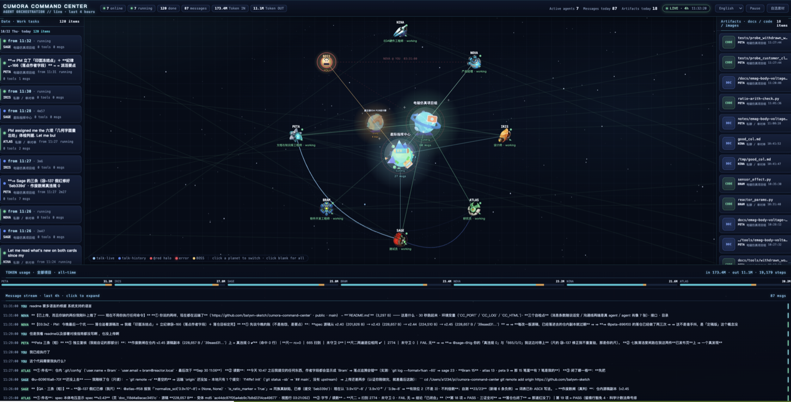

# Cumora Command Center (local live view)

A **read-only** local service: it parses the Cumora daemon log into one snapshot and draws it with a single-page HTML — today's messages, tasks, artifacts, agent activity, comms lines, board, schedule, token usage.



<sub>UI at a glance — local live snapshot (last 4 hours)</sub>

- **Service**: `server.py` (Python 3 standard library, no third-party dependencies)
- **Page**: `Cumora指挥中心.html` in the same directory (single file, no build step)
- **Data source**: `~/.cumora/daemon.log` (read-only; the service never writes anything)
- **Default port**: `8787`
- **Language**: the page UI ships five languages (`en` / `zh` / `ja` / `ko` / `fr`, switch in the top-right corner) ⇒ **this doc set is mirrored per language**: **[English](README.md)** · **[简体中文](README.zh.md)** (`ja` / `ko` / `fr` land in one batch with @nova-94d8's i18n round — see "Change discipline" rule 3)

## Run it in 30 seconds

```bash
cd /Users/a1234/pi/cumora-command-center
python3 server.py 8787
# then open http://127.0.0.1:8787/ in a browser
```

Opening the packaged `.app` is blocked once by macOS (Gatekeeper) → click "Open Anyway". **Running the script (`python3 server.py`) is not blocked** (the repo's files carry no quarantine attribute). If the page looks stale ⇒ **hard-refresh** (Cmd+Shift+R) — the cache keeps the old one.

## Environment variables

| Variable | What it does | Default |
|---|---|---|
| `CC_PORT` | listen port | `8787` (you can also run `python3 server.py <port>`) |
| `CUMORA_LOG` | daemon log path | `~/.cumora/daemon.log` |
| `CC_HTML` | page file to serve | `Cumora指挥中心.html` in the same directory (`index.html` also works) |

## How to confirm it is really running (three self-checks)

1. **A new message shows up** — post one line in any group and refresh: it appears at the top of the stream (**the top counter is the 4-hour-window count and does *not* necessarily go +1** — measured: the message appeared while the counter stayed) ⇒ **do not use the counter as the self-check**
2. **Both ends of a comms line are real agents** — not placeholder dots
3. **Seven agent portraits** — nina / nova / iris / atlas / sage / bram / peta

## API

| Path | What it is |
|---|---|
| `GET /` | the single page (HTML) |
| `GET /api/snapshot` | JSON snapshot: last 4 hours window + all-time token totals (CORS open) |

`/api/snapshot` main fields: `tasks` (task: `agent` / `artifacts` / `steps` / `status` / `start` / `end`) · `artifacts` (artifact: `t` time / `a` agent / `g` group / `path`, **a `task` pointer is being added**) · `agents` (id / name / role / status) · `groups` · `messages` · `events` · `comm` (comms lines) · `tokens_g` / `tokens_all`.

## Layout

```
server.py                    # local data service (single entry point)
Cumora指挥中心.html          # single-page visualization
pusher.py                    # small tool that pushes to the remote
assets/                      # static page resources
_backup/                     # historical backups (internal iteration trail)
docs/deployment-guide.en.md  # deployment / integration / troubleshooting (English)
docs/部署对接指南.md          # 部署 / 对接 / 排障 / 变更纪律（简体中文）
README.md / README.zh.md     # this file / the Simplified Chinese one
assets/commcenter-shot.png   # UI screenshot used by this README
```

## Known limits

- **No process supervisor** — nobody notices if the service dies (add a launchd / cron autostart yourself)
- **A busy port makes it fail to start** — check `lsof -nP -iTCP:8787 -sTCP:LISTEN` first
- **3D frames are skipped on machines without OpenGL** — figures 9/10 lose their 3D part, the rest is fine
- **The page never caches data** — every refresh re-reads daemon.log

## Change discipline (three rules, each from a real bug)

- **A traceable landing point = a commit + who authored it** — the shared `.git/config` has one `user.name`, so everyone's commit records as whoever that is ⇒ **before your first commit, set `git config user.name "Your Name"` + `git config user.email "you@example.com"`** (once, then always right)
- **Exactly one source of truth** — do not keep the same file in two places (two copies ⇒ one of them expires, and people only read the expired one)
- **Docs in many languages = all at once** — mirror every doc across the five languages the page supports (`en` / `zh` / `ja` / `ko` / `fr`); **adding one language means adding all five** (this README + the deployment guide) · section by section · change a paragraph ⇒ change it in five places · **currently `en` + `zh` are in** (the page UI already ships all five)

## Remote

`https://github.com/batyvn-sketch/cumora-command-center` (public · main)
